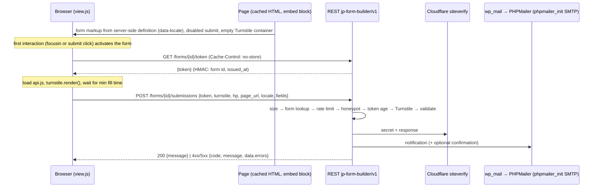

# JayPee Solutions Form Builder: Implementation plan

Scope and rationale: [prd.md](prd.md). Decisions: [adr/](adr/).

## Template mapping

1. PHP ≥ 8.0 (composer platform 8.0.30), WP ≥ 6.6 (the template default 6.4 is raised for the JSX runtime, ADR 0006), tested up to 7.1; wp-env core 7.1.4 on PHP 8.5; Node 22.13+.
2. Code layout: flat `includes/class-*.php` loaded by explicit `require_once` from `jp-form-builder.php`, all in namespace `JayPee\FormBuilder`. No PSR-4 autoloading of plugin code; Composer autoload covers vendor only. The bootstrap closure on `plugins_loaded` is where "Register the plugin's own features here." goes (template-owned; edits merge via copier).
3. PHPCS: WordPress standard, 4-space indent, short arrays, light docblocks, text domain `jp-form-builder`. `composer lint` = phpcs + check-test-seams + check-i18n (msgfmt) + check-hook-names. Hooks must start with `jp_form_builder_`, exist in core, or be in `scripts/hook-allowlist.txt`. `scripts/check-test-seams.sh`: integration tests must go through hooks/REST, so test seams are filters (`jp_form_builder_min_fill_seconds`).
4. Tests: unit PHPUnit 9 (`tests/`, bootstrap with namespace stubs, no WP; `tests/stubs.php` holds namespace-local WP stubs and the `$GLOBALS['jp_form_builder_test_http_*']` pattern, which Turnstile unit tests extend with a `wp_remote_post` stub); integration via wp-env `tests-cli` (`npm run test:integration`, `WP_UnitTestCase`, MockPHPMailer); Playwright E2E (`npm run test:e2e:run`, `tests/seed.php`, `withOptions`, `wpCli`). Done criterion: `OK (N tests, M assertions)`, exit 0.
5. Release: `scripts/build-release.sh` runs `composer install --no-dev` and php-scoper (prefix `JayPee\FormBuilder\Vendor`), then zips `build/jp-form-builder-vX.Y.Z.zip`. Copy list: `README.md readme.txt LICENSE includes assets admin blocks languages`; the built `blocks/` fits. `build/` is the release output and is wiped, so wp-scripts must not output there. Version lives in the plugin header, the `VERSION` const and readme.txt `Stable tag`; a CHANGELOG section is required. `scoper.inc.php` `exclude-functions /.*/` is only safe while no bundled package declares global functions (reason libphonenumber is rejected, ADR 0004).
6. Updates: Plugin Update Checker → github.com/jaypee-solutions/jp-form-builder, plus a token page under Settings (ADR 0007).
7. No JS build or JS/CSS lint in the template. Sibling jp-catalog-suite ships buildless blocks, `uninstall.php`, `docs/adr` + `.okf` mirrors and i18n scripts (`wp i18n make-pot` / `make-json` via wp-env cli); German strings are formal "Sie" in `de_DE.po`, copied byte-identically to `de_DE_formal.po`.
8. CI (`.github/workflows/ci.yml`): lint and unit in a `composer:2` container; integration job runs node 22 + wp-env + E2E; build job builds the ZIP. Release workflow: lint, unit, release. Workflows, scripts and lint config are template-owned.
9. WP 7.1.4 `rest_cookie_check_errors()`: with no nonce it calls `wp_set_current_user( 0 )` and treats the request as unauthenticated. A public REST submit needs no nonce and never goes stale behind a page cache.
10. WP 7.1.4 `WP_REST_Posts_Controller::check_read_permission()`: any `publish` post of a `show_in_rest` type is readable anonymously. A non-public CPT still needs a custom REST controller.
11. `register_block_script_handle()` calls `wp_set_script_translations( $handle, $textdomain )` without a path, so bundled `languages/*.json` need an explicit call with `PLUGIN_DIR . 'languages'`. `parse_blocks()` omits attributes left at defaults, so defaults are merged from `block.json`.

Mapping: CPT + blocks built by wp-scripts (via the template's new optional `uses_blocks` question, see Template deviations), flat `includes/` classes, unit/integration/E2E harness reused, release via `build-release.sh` with the build step.

## Architecture & data flow

## File layout

Each file holds one class in `JayPee\FormBuilder`, required from `jp-form-builder.php` and wired in `Plugin::init()` on `plugins_loaded`.

| File | Class | Role |
|---|---|---|
| includes/class-plugin.php | Plugin | registers every hook |
| includes/class-settings.php | Settings | key spec, precedence constant → option → default, `get()`, `source()`, `is_locked()`, `save()` |
| includes/class-secret-box.php | Secret_Box | sodium secretbox for stored secrets (SMTP password, Turnstile secret, M365 client secret), format `v1:<base64>` |
| includes/class-settings-page.php | Settings_Page | Forms → Settings (`edit.php?post_type=jp_form&page=jp-form-builder-settings`); sections SMTP, Turnstile, Mail (layout + site default subjects/bodies, live preview, reset, test mail), Backup & restore, mail-failure list; locked-field display, config notices (Turnstile missing, untrusted proxy, Confirmation disabled) |
| includes/class-mailer.php | Mailer | `phpmailer_init`, `wp_mail_from(_name)`, `send( Mail ): true\|WP_Error` capturing `wp_mail_failed`, `send_test()` |
| includes/class-mail-log.php | Mail_Log | redacts addresses, `error_log('jp-form-builder: …')`, keeps last 10 failures in option `jp_form_builder_mail_log` (autoload no) |
| includes/class-mail.php | Mail | value object: to[], subject, html_body, text_body, headers[] |
| includes/class-mail-builder.php | Mail_Builder | pure: notification + confirmation from definition + values; renders both bodies through Mail_Template |
| includes/class-mail-template.php | Mail_Template | pure: placeholder/section renderer (`html` and `text` modes), generated `{all_fields}` table (minimal inline styles, inherits font/colour), kses for Body templates, HTML → text conversion |
| includes/class-mail-layout.php | Mail_Layout | layout HTML: setting `mail_layout` → bundled `templates/mail/layout.html`; filter `jp_form_builder_mail_layout`; layout kses profile (tables, inline `style`, `<style>`; no `img`, scripts or remote URLs); requires `{content}` |
| includes/class-mail-header-guard.php | Mail_Header_Guard | pure: rejects CR, LF, NUL in header-bound values |
| templates/mail/layout.html | — | bundled default layout: static HTML with placeholders, inline CSS, table based, system fonts, no remote assets |
| src/admin/settings.js, src/admin/mail-settings.js | — | settings page mail section (built by wp-scripts into `admin/build/`, gitignored): the Mail layout and the site-default Notification and Confirmation texts use the same React components as the Form's Body template modal (`src/shared`: code editor, placeholder inserter, sandboxed live preview); PHP renders plain fields the script takes over and reads its values from |
| includes/class-form-post-type.php | Form_Post_Type | CPT `jp_form` with top-level Forms menu, caps from filter `jp_form_builder_capability` (default `manage_options`), `allowed_block_types_all` |
| includes/class-form-posts-controller.php | Form_Posts_Controller | extends `WP_REST_Posts_Controller`; item(s) reads require the Form capability (`jp_form_builder_capability`, default `manage_options`) |
| includes/class-blocks.php | Blocks | registers built `blocks/*`, explicit script translations, embed render (site key + locale in markup; Cloudflare is loaded by view.js only) |
| includes/class-block-defaults.php | Block_Defaults | pure: attribute defaults from `*/block.json` |
| includes/class-form-definition.php / class-field-definition.php | Form_Definition / Field_Definition | value objects |
| includes/class-form-definition-parser.php | Form_Definition_Parser | pure: parsed blocks + defaults → definition (ordered items: fields and pass-through blocks) |
| includes/class-form-repository.php | Form_Repository | `find( int $id ): ?Form_Definition` (published `jp_form` only); `find_by_rev( int $id, string $rev ): ?Form_Definition` matches `rev` against the current content or one of the last 10 revisions (ADR 0014) |
| includes/class-form-renderer.php | Form_Renderer | HTML from definition; non-field items through `render_block()` |
| includes/class-field-validator.php | Field_Validator | pure, per type |
| includes/class-text.php | Text | pure: `single_line()`, `multi_line()`, UTF-8 check, character-based `truncate()`, `lowercase()` |
| includes/class-form-blocks.php | Form_Blocks | the Field types and the blocks allowed in a Form, used by the parser, the Form post type, the Backup and the mail preview |
| includes/class-field-key.php | Field_Key | pure: the one Field key rule (lowercase, ä→ae ö→oe ü→ue ß→ss, other Latin accents removed, `[^a-z0-9_]`→`_`, trimmed `_`); `src/shared/field-key.js` follows it and both run `tests/fixtures/field-keys.json` |
| includes/class-recipient-list.php | Recipient_List | pure: the valid, unique addresses of a comma-separated list; Form Recipients, the default recipient setting and the saved `default_recipient` share it |
| includes/class-mail-remote-assets.php | Mail_Remote_Assets | pure: removes what makes a mail client fetch remote content (image/media sources, `poster`, remote CSS `url()`, `@import`); Body templates and the Mail layout share it |
| includes/class-phone-normalizer.php | Phone_Normalizer | pure |
| includes/class-countries.php | Countries | 32 codes + translated names, postcode patterns |
| includes/class-form-token.php | Form_Token | pure: issue/verify with injected secret |
| includes/class-turnstile-verifier.php | Turnstile_Verifier | `wp_remote_post` siteverify |
| includes/class-m365-token-provider.php | M365_Token_Provider | implements `PHPMailer\PHPMailer\OAuthTokenProvider`; client-credentials token via `wp_remote_post`, cached in transient `jp_form_builder_m365_token` until 5 min before expiry; maps Entra errors (e.g. expired secret) to readable log messages |
| includes/class-client-ip.php | Client_Ip | pure: built with the trusted proxy IPs/CIDRs (`Client_Ip::from_settings()` reads `JP_FORM_BUILDER_TRUSTED_PROXIES`); REMOTE_ADDR, or behind a trusted proxy the rightmost untrusted X-Forwarded-For entry; `looks_proxied()` for the settings notice |
| includes/class-rate-limiter.php | Rate_Limiter | fixed-window counter per HMAC key: `jp_form_builder_rl_<hash32>` (IP) and `jp_form_builder_cf_<hash32>` (Confirmation address) |
| includes/class-rest-controller.php | Rest_Controller | routes |
| includes/class-submission-handler.php | Submission_Handler | pipeline |
| includes/class-cli-command.php | Cli_Command | `wp jp-form-builder …`, loaded only when `WP_CLI` |
| includes/class-privacy.php | Privacy | privacy-policy suggestion text |
| includes/class-form-backup.php | Form_Backup | export forms (+ non-secret settings) to a JSON document, validate and restore it |
| uninstall.php | — | cleanup incl. all `jp_form` posts (see Backup, restore & uninstall) |
| src/blocks/{form,embed,name,email,phone,address,text,select,textarea,consent}/ | — | block.json, index.js, edit.js; embed also view.js, style.css |
| src/shared/ | — | field inspector controls, field-key helper, form.css |

## Blocks

- `jp-form-builder/form` ("Form fields"). Inserter off; it is the CPT template with `template_lock => 'insert'`. InnerBlocks use `templateLock={false}` and allow the 8 field blocks + `core/paragraph` + `core/heading`. Default inner template: name, email, textarea, consent.
  - Attributes (empty string = site default from settings → built-in translated default): `submitLabel`, `successMessage`, `recipients` (comma list; empty → setting `default_recipient` → `admin_email`), `subject`, `notificationBody` (HTML Body template; built-in `{all_fields}`), `confirmationEnabled` false, `confirmationSubject`, `confirmationBody` (built-in: a short translated acknowledgement). Subjects and bodies open in a modal with the core code editor (`wp_enqueue_code_editor` on `jp_form` screens), a placeholder inserter listing this Form's Fields, and a preview rendered in the Mail layout via `POST /mail-preview`. The Confirmation toggle is disabled with an explanation while Turnstile is not configured (ADR 0011).
  - `save` = InnerBlocks.Content; the render callback returns '' when rendered directly.
- Field blocks: `parent: ["jp-form-builder/form"]`, `save: null`, render callback ''.
  - Common attributes: `label`, `fieldName` (key; the editor sets a unique slug on insert), `required`, `helpText`, `placeholder` (not on consent/address/select).
  - Specific: name `split` false, `firstLabel`, `lastLabel`; email `replyTo` true; phone `defaultRegion` "DE" (DE|AT|CH); address `defaultCountry` "DE"; text `maxLength` 200; select `options` [{label,value}], `placeholder`; textarea `rows` 6, `maxLength` 5000; consent `text` (contains `{privacy_policy}`), `linkText`, `privacyUrl` (empty → `get_privacy_policy_url()`), always required.
- `jp-form-builder/embed` ("Form").
  - Attribute `formId` 0. Supports `align: ["wide"]`, `spacing.margin`. `viewScript` view.js; `style` style-index.css.
  - Editor: picker from `GET /jp-form-builder/v1/forms`, an "Edit form" link for users with the Form capability, and a ServerSideRender preview.
- Field keys: the parser uses `fieldName`. Empty → `<type>_<n>` (1-based per type). A duplicate gets `_2`, `_3`, … in document order. Render and validation share the same definition, so keys always agree. Compound subkeys: name `first`/`last`, address `street`/`postcode`/`city`/`country`. DOM ids: `jpfb-<formId>-<instance>-<key>[-]`.
- Revision (ADR 0014): the embed renders `data-rev` = first 16 hex chars of SHA-256 over the Form's `post_content`; view.js sends it as `rev`. `jp_form` supports revisions.
- Activation (ADR 0002): view.js waits for the first `focusin` or submit click, then fetches the token and, when both Turnstile keys are set, loads `https://challenges.cloudflare.com/turnstile/v0/api.js?render=explicit` and calls `turnstile.render()` with `action: 'jpfb-submit'` and `appearance: 'interaction-only'`, so the widget only appears when a challenge needs the visitor. The embed render only registers the site key in the markup and never enqueues Cloudflare itself; the editor's ServerSideRender preview shows no widget. view.js reads the widget response and calls `turnstile.reset()` after every attempt.
- Submit button: rendered `disabled` (no-JS state); view.js swaps it to `aria-disabled="true"` so it stays focusable, and a click before activation is ready announces "Please wait…" in the status region and submits once the token, Turnstile and min fill time are ready.
- Pre-validation: field markup carries the server rules as attributes (`required`, `maxlength`, `type`, `pattern`, option values); view.js checks them before sending and shows the same error summary. The server stays authoritative.
- Honeypot: off-screen field with a non-semantic name, `tabindex="-1"`, `aria-hidden="true"`, `autocomplete="off"`, so browser autofill never fills it (a filled honeypot gets a silent fake 200).
- Failure states keep the visitor's input; a 500 tells the visitor to try again later or use another contact channel.
- Locale (ADR 0013): the embed renders `data-locale` from `determine_locale()`; view.js sends it as `locale`.

## Settings & constants

Option `jp_form_builder_settings` (array). A constant wins and locks the field; secrets are never rendered, only "set"/"not set".

| Key | Constant | Default |
|---|---|---|
| smtp_host | JP_FORM_BUILDER_SMTP_HOST | '' (empty = SMTP off) |
| smtp_port | JP_FORM_BUILDER_SMTP_PORT | 587 |
| smtp_encryption | JP_FORM_BUILDER_SMTP_ENCRYPTION | starttls (none\|starttls\|smtps) |
| smtp_auth | JP_FORM_BUILDER_SMTP_AUTH | true |
| smtp_user | JP_FORM_BUILDER_SMTP_USER | '' |
| smtp_password (secret) | JP_FORM_BUILDER_SMTP_PASSWORD | '' |
| from_email | JP_FORM_BUILDER_FROM_EMAIL | '' |
| from_name | JP_FORM_BUILDER_FROM_NAME | '' |
| force_from | JP_FORM_BUILDER_FORCE_FROM | false |
| turnstile_site_key | JP_FORM_BUILDER_TURNSTILE_SITE_KEY | '' |
| turnstile_secret_key (secret) | JP_FORM_BUILDER_TURNSTILE_SECRET_KEY | '' |
| default_recipient | JP_FORM_BUILDER_DEFAULT_RECIPIENT | '' |
| smtp_auth_method | JP_FORM_BUILDER_SMTP_AUTH_METHOD | password (password\|m365_oauth) |
| m365_tenant_id | JP_FORM_BUILDER_M365_TENANT_ID | '' |
| m365_client_id | JP_FORM_BUILDER_M365_CLIENT_ID | '' |
| m365_client_secret (secret) | JP_FORM_BUILDER_M365_CLIENT_SECRET | '' |
| mail_layout | — (WP-CLI via STDIN) | '' (bundled `templates/mail/layout.html`) |
| notification_subject / notification_body | — | '' (built-in "New message via {form_title}" / `{all_fields}`) |
| confirmation_subject / confirmation_body | — | '' (built-in translated acknowledgement) |

Constant-only settings: `JP_FORM_BUILDER_MAX_PAYLOAD_BYTES` 32768, `JP_FORM_BUILDER_RATE_LIMIT` 10, `JP_FORM_BUILDER_RATE_WINDOW` 600, `JP_FORM_BUILDER_MIN_FILL_SECONDS` 3 (filter `jp_form_builder_min_fill_seconds`), `JP_FORM_BUILDER_TRUSTED_PROXIES` '' (comma list of IPs/CIDRs, e.g. `10.0.0.0/8`), `JP_FORM_BUILDER_MAX_BACKUP_BYTES` 2097152 (restore upload limit). Turnstile hostnames: `home_url` host, filter `jp_form_builder_turnstile_hostnames`.

## REST contract

Namespace `jp-form-builder/v1`, no nonce.

- `GET /forms/(?P<id>\d+)/token` (public) → 200 `{token}`, `Cache-Control: no-store`; 404 `jpfb_form_not_found`.
- `POST /forms/(?P<id>\d+)/submissions` (public), JSON `{token, turnstile, hp, page_url, locale, rev, fields:{key: string|{sub:string}}}`:
  - 200 `{message}`
  - 413 `jpfb_payload_too_large`
  - 404 `jpfb_form_not_found`
  - 429 `jpfb_rate_limited`
  - 400 `jpfb_token_invalid`
  - 400 `jpfb_turnstile_failed`
  - 503 `jpfb_turnstile_unavailable`
  - 422 `jpfb_invalid_fields` with `data.errors {key or key.sub: message}`
  - 409 `jpfb_form_changed` ("This form was updated. Please reload the page.")
  - 500 `jpfb_mail_failed` (generic message)
- `GET /forms` (`edit_posts`) → `[{id,title}]` for the embed picker.
- `POST /mail-preview` (Form capability; `manage_options` for the layout) JSON `{form_id?, kind: notification|confirmation, subject, body, layout?, fields?: [{key, label, type, split?}]}` → `{subject, html}` rendered with sample Field values (the given `fields` when present, else name/email/message; invalid entries are dropped); nothing is sent.

## Submission pipeline

Order in `Submission_Handler`:

1. Body byte size over the limit → 413.
2. Resolve form → 404. Switch to `locale` when it is in `get_available_languages()` or `en_US`; otherwise keep the site locale.
3. Rate limit, which counts every attempt → 429.
4. Honeypot non-empty → fake 200, nothing sent.
5. Token: HMAC with `wp_salt('nonce')`, form id match, age ≥ min fill and ≤ 7200 s → else 400.
6. Turnstile when both keys are set: `success`, hostname ∈ allowed, `action === 'jpfb-submit'`; transport/non-200/bad JSON → 503.
7. Validate against the Fields of the revision matching `rev` (current content or one of the last 10 revisions); no match → 409. Mail settings always come from the current Form → 422 on invalid fields.
8. Notification mail → 500 on failure (logged).
9. Confirmation mail, only while Turnstile is configured and the address's hourly throttle passes; a failure is logged only.
10. 200.

Unknown field keys are ignored.

## Validation rules

`Text` helpers first: valid UTF-8, control chars stripped, trimmed.

- Name: ≤ 100 chars per part.
- Email: domain converted with `idn_to_ascii()` when ext-intl is available, then `filter_var FILTER_VALIDATE_EMAIL`, ≤ 254, header-safe.
- Text: single line, ≤ `maxLength`.
- Phone: `Phone_Normalizer` → E.164 string.
- Address: street ≤ 200, city ≤ 100, country ∈ list, postcode DE `^\d{5}$`; AT/CH/LI `^\d{4}$`; other `^[A-Za-z0-9][A-Za-z0-9 -]{1,9}$`.
- Select: value ∈ option values.
- Textarea: ≤ `maxLength`, newlines kept.
- Consent: must be `"1"`.
- Optional fields: empty is accepted; compound fields count as empty only if every part is empty.

`Phone_Normalizer::normalize( string $input, string $region ): ?string`:

- Allowed chars: digits, space, `+ - / ( ) .`.
- Remove `(0)`. `+` or `00` → international. Leading `0` → region CC (DE 49, AT 43, CH 41) + rest. Anything else → null.
- For CC 49/43/41, strip one leading 0 of the national number.
- Total digits 8–15, CC first digit ≠ 0. National number length: DE 6–13, AT 4–13, CH exactly 9.

| Input | Region | Result |
|---|---|---|
| `0821 123456` | DE | `+49821123456` |
| `+49 (0) 821 / 12 34-56` | DE | `+49821123456` |
| `0049 821 123456` | DE | `+49821123456` |
| `+49 0821 123456` | DE | `+49821123456` |
| `0171 1234567` | DE | `+491711234567` |
| `01 234567` | AT | `+431234567` |
| `+1 202 555 0100` | — | `+12025550100` |
| `12345`, `abc`, 16+ digits | — | null |

## Mail

PHPMailer mapping:

- Host set → `isSMTP()`, Host, Port, `SMTPAuth`, Username/Password, `SMTPSecure` ''/'tls'/'ssl', `SMTPAutoTLS = false` for none, Timeout 15.
- From: `force_from` → always override From and From name. Otherwise override only WP's default `wordpress@<host>`.
- `Sender` = `from_email` when configured.
- Never enable SMTPDebug output: AUTH lines leak credentials.

HTML mail with full templating ([ADR 0010](adr/0010-html-mail-templating.md)). Every mail is `multipart/alternative`: HTML body plus a plain-text alternative derived from the same rendered HTML (`AltBody` set in `phpmailer_init` from the pending `Mail`). No remote images or tracking; filter `jp_form_builder_mail_allowed_html` can widen the Body template tags.

Templating layers, all edited in the admin area:

- Body template per Form (`notificationBody` / `confirmationBody`, Form editor modal) → site default (`notification_body` / `confirmation_body`, settings page) → built-in. HTML restricted by `wp_kses` (post tags minus `img`, `form`, `script`, `style`; `style` attributes allowed). Subjects follow the same precedence.
- Mail layout (`mail_layout`, settings page code editor): frames every mail around `{content}`; placeholders `{site_name}`, `{site_url}`, `{form_title}`; layout kses profile (see Mail_Layout). Empty → bundled `templates/mail/layout.html`; "Reset to default" clears the setting. No theme-file override; developers use filter `jp_form_builder_mail_layout`.
- Field table `{all_fields}`: generated, not editable; Body templates list Fields individually when a custom look is needed.
- Preview: `POST /mail-preview` renders subject + HTML with sample values for each Field in the real Mail layout; the admin shows it in a sandboxed `iframe srcdoc`.
- Placeholder syntax, single pass (values are never re-parsed, so a submitted `{key}` stays literal):
  - `{<key>}` value, compound values joined with spaces; `{<key>:label}` the field label
  - `{#<key>}…{/<key>}` section rendered only when the field is non-empty
  - `{all_fields}` the field table (HTML) or `Label: value` lines (text)
  - `{form_title}`, `{site_name}`, `{page_url}` (only if host equals home host), `{submitted_at}` (UTC)
  - unknown placeholders are removed
- Escaping: in HTML mode values pass `esc_html` (+ `nl2br` for textarea); in text mode they are single-line/indented raw text. Template author content is trusted-after-kses; submitter content is never HTML.

Notification:

- To: valid recipients.
- Subject: placeholders `{<key>}`, `{form_title}`, `{site_name}` (plain text only). Values are single-line, ≤ 200 chars each, subject ≤ 250, unknown placeholders removed.
- `Reply-To: <name> <email>` from the first non-empty email field with `replyTo`. `wp_mail()` splits address headers at commas and keeps quote characters in the display name, so the name has `"<>,` and CR/LF removed and is not quoted; the header is just the address when the name is empty and omitted if the guard fails.
- Built-in body also names the page (`Page: <page_url>`) when its host equals the home host.
- Default body (`{all_fields}`): `Label: value` rows, textarea values multi-line, consent "Yes (<UTC timestamp>)", plus `page_url` only if its host equals the home host.

Confirmation: to the Submitter, Reply-To = first recipient, only while Turnstile is configured and at most one per address per hour (ADR 0011). The render context contains no submitted values (anti-relay, [ADR 0008](adr/0008-no-entry-storage.md)): `{form_title}`, `{site_name}`, `{submitted_at}` only; `{<key>}`, `{all_fields}` and sections resolve to empty.

Microsoft 365 (ADR 0012): `smtp_auth_method = m365_oauth` sets Host `smtp.office365.com`, Port 587, STARTTLS, `AuthType = 'XOAUTH2'` and `setOAuth( M365_Token_Provider )`; `smtp_user` is the sending mailbox. The token request is a client-credentials POST to `https://login.microsoftonline.com/<tenant>/oauth2/v2.0/token` with scope `https://outlook.office365.com/.default`. The README documents the Entra app registration, the Exchange service principal and the mailbox permission. Google OAuth is out of scope (app passwords work).

## WP-CLI

`wp jp-form-builder`:

- `mail test <to>` (sends the HTML layout + text alternative)
- `settings list [--format=<table|json|yaml>]` (key, value masked, source)
- `settings set <key> [<value>]` (value from STDIN when omitted, for secrets and templates, e.g. `settings set mail_layout < layout.html`; errors if locked)
- `settings delete <key>`
- `form list [--format]`
- `backup export [<file>]` (stdout when file omitted; forms + non-secret settings)
- `backup restore <file> [--overwrite] [--dry-run]`

## Backup, restore & uninstall

Decision: [ADR 0009](adr/0009-form-backup-restore-and-clean-uninstall.md).

- Forms → Settings → "Backup & restore" section: **Download backup** (`admin-post` action, nonce, `manage_options`) and **Restore from backup** (file upload, same checks, size ≤ `JP_FORM_BUILDER_MAX_BACKUP_BYTES`, optional "overwrite existing forms with the same ID"). A static sentence in the section states that deleting the plugin removes all forms. The Plugins list row gets a "Back up forms" action link to the download. No admin notices.
- Backup JSON: `{ "format": "jp-form-builder-backup", "version": 1, "plugin_version", "exported_at", "forms": [{ "id", "title", "status", "slug", "content" }], "settings": { non-secret keys } }`. Secrets (`smtp_password`, `turnstile_secret_key`, `m365_client_secret`) are never exported; constant-locked keys are omitted. No submissions exist to export (ADR 0008).
- Restore validation: JSON schema + `version` check; every form's `content` must parse to exactly one top-level `jp-form-builder/form` block with allowed children, otherwise that form is rejected and reported. `post_type` is forced to `jp_form`. Settings restore only known, non-secret, non-locked keys through the normal sanitisers.
- Restore semantics: a form whose ID is free is inserted with that ID (`import_id`) so existing embed blocks keep working; if the ID is taken by another post, a new post is created and the result reports `old ID → new ID` (embeds are not rewritten). A `jp_form` with the same ID is skipped unless overwrite is set. The result report lists restored, skipped, rejected.
- `uninstall.php`: deletes `jp_form_builder_settings`, `jp_form_builder_mail_log`, `jp_form_builder_github_token`, `external_updates-jp-form-builder` (Plugin Update Checker state), every `_transient_(timeout_)jp_form_builder_%` row (rate limit, Confirmation throttle, OAuth token), and force-deletes every `jp_form` post (any status) with its meta and revisions. Embed blocks in page content remain and render nothing once the form is gone. The README documents the backup-first workflow. Single-site only; network activation is not supported.

## Template deviations

Decision: upstream now ([ADR 0006](adr/0006-wp-scripts-block-build.md)). The block build lands in wp-plugin-template as an optional Copier question `uses_blocks` (default false, so existing plugins are unaffected), developed on branch `feat/optional-block-build` in `~/GitHub/wp-plugin-template` (worktree `~/GitHub/wp-plugin-template-blocks`, not pushed or tagged yet). jp-form-builder adopts it with `copier update` after the scaffold commit (P1), so there are no local copies of template-owned files.

What `uses_blocks=true` provides:

- `@wordpress/scripts` ^37 devDependency; Node engine ^22.22.2, so the README requirement changes. `Requires at least: 6.6` in the plugin header and readme.txt, because the JSX output depends on `react-jsx-runtime` (ADR 0006).
- Scripts `build` = `wp-scripts build --source-path=src/blocks --output-path=blocks`, `start`, `lint:js`, `lint:css`.
- `blocks/` gitignored; `build-release.sh` runs `npm ci && npm run build` before copying.
- ci.yml: new `js` job; `npm run build` in the integration job; setup-node in the build job. release.yml: setup-node in the release job.
- `.editorconfig` `[src/**] indent_style = tab`, which `block.json` files in `src/` follow too.
- `uninstall.php` must be in the release copy list of `scripts/build-release.sh` (`README.md readme.txt LICENSE uninstall.php includes …`); the template's list lacks it, so a template-generated release ZIP would never clean up. Add it upstream.
- The settings page script is a second wp-scripts build: `build` runs `build:blocks` (`src/blocks` → `blocks/`) and `build:admin` (`src/admin/settings.js` → `admin/build/`, gitignored as `/admin/build/`, shipped through the `admin` entry of the copy list); `start` watches both. Upstream the template's `build`/`start` scripts and `.gitignore` accordingly. `npm run test:js` (Node's test runner, no new package) runs `tests/js`, which share fixtures with PHPUnit.
- `npm run i18n:pot` (make-pot excluding `src,node_modules,vendor,tests,.wp-env,build`, JS references from the built `blocks/`). Contingency: `wp i18n make-json --use-map`.
- ESLint contingency: allow `@wordpress/*` externals in `eslint.config.mjs` instead of adding packages.

Stays plugin-local (not upstreamed): `.wp-env.json` `env.development.mappings` for the E2E mail-capture mu-plugin (`tests/e2e/mu-plugins/capture-mail.php`: `pre_wp_mail` → option `jp_form_builder_e2e_last_mail`, min-fill filter → 0).

Template follow-ups: v1.5.0 shipped the WP 6.6 floor and `templates/` in release ZIPs (PRs #31, #32). Still to upstream: `.gitignore` must anchor the build output as `/blocks/` (unanchored `blocks/` also hides `src/blocks/`); `lint:js`/`lint:css` cover `src/` instead of `src/blocks/` (shared editor code lives in `src/shared/`); `eslint.config.mjs` lists the used `@wordpress/*` externals under `import/core-modules`; `phpunit-integration.xml.dist` should keep `.phpunit.result.cache` out of the checkout.

## Test plan

Each phase ends green on `composer lint`, `composer test` (`OK (…)`, exit 0), and, from P1 on, `npm run lint:js && npm run lint:css && npm run build`. P3–P6 also need `npm run test:integration`; P6 needs `npm run test:e2e:run`. Per-phase test content is listed under Phases.

## Phases & commits

Commit each phase separately (Conventional Commits). P0 (these docs) is first committed together with the untracked scaffold as `chore: scaffold from wp-plugin-template v1.4.0`, after review.

- **P0b Template upstream (other repo), done:** optional `uses_blocks` Copier question in wp-plugin-template, released as [v1.5.0](https://github.com/jaypee-solutions/wp-plugin-template/releases/tag/v1.5.0) (PRs #31, #32).
- **P1 Foundation, done:** `copier update` to template `v1.5.0` with `uses_blocks=true`, Plugin, Settings + Secret_Box, Form_Post_Type (top-level Forms menu, capability filter, revisions) + Form_Posts_Controller, settings page skeleton under the Forms menu, minimal uninstall.php (settings + transients; posts added in P5). Unit: settings precedence and locking, Secret_Box round-trip. Integration: anonymous `GET /wp/v2/jp_form/<id>` → 401/403; an Editor cannot edit a Form until the filter widens the capability; the settings page requires `manage_options`.
- **P2 Mail/SMTP + HTML templating, done:** Mailer, Mail_Log, Mail, Mail_Builder, Mail_Template, Mail_Layout, default layout, Mail settings section (code editor, preview, reset, site defaults), `POST /mail-preview`, test mail (page + CLI), settings CLI. Unit: header guard, Mail_Builder headers and subject, precedence Form → site default → built-in, Mail_Template (HTML escaping of values, sections, `:label`, unknown placeholders removed, no re-expansion of submitted `{key}`, kses strips `script`/`img`, text conversion), Mail_Layout (missing `{content}` rejected, `img` and remote URLs stripped). Integration: `phpmailer_init` maps settings onto MockPHPMailer incl. `AltBody` and `Content-Type`; a saved layout is used and reset restores the bundled one; `/mail-preview` and the test mail action require the right capability.
- **P2b Microsoft 365 OAuth, deferred** (first customer does not use Microsoft 365; settings hidden until then): M365_Token_Provider, settings fields, test mail via XOAUTH2 (ADR 0012). Unit: token request, caching and expiry, XOAUTH2 provider output, error mapping for expired secrets. Integration: `phpmailer_init` sets `AuthType` XOAUTH2 and the provider; the token request goes through `pre_http_request`.
- **P3 Forms model, done:** all blocks incl. text (editor) with the Body template modal and a "Form settings" document panel, Block_Defaults, parser, repository (incl. revision lookup), renderer (`data-rev`), editor data (countries, `turnstileConfigured`, `canEditForms`) as inline script, `/mail-preview` with the Form's `fields`. Unit: parser keys, defaults, duplicates. Integration: repository ignores drafts; `find_by_rev()` resolves an older revision by `rev` (checked through the embed's `data-rev` and a stale-rev Submission). E2E: default template, label round-trip, unique Field key, Body template modal and document panel persistence.
- **P4 Submission, done:** REST routes, token, validators, phone, Turnstile, rate limit, client IP, locale switch, Confirmation gating, handler, view.js (activation, pre-validation, accessibility), E2E mail-capture mu-plugin and seeded `e2e-contact` Form.
  - Unit: phone table above, address/email (incl. IDN)/text/select validation, Turnstile (mocked: success, false + error-codes, hostname mismatch, action mismatch, WP_Error, non-200, bad JSON, empty token → no request), Client_Ip (CIDR v4/v6, rightmost untrusted entry, spoofed header without trusted proxy ignored).
  - Integration through `rest_get_server()->dispatch()` with `pre_http_request`: happy path sends one mail with Reply-To; honeypot → 200 and no mail; Turnstile fail → 400; token too fast → 400; 11th request → 429; oversized → 413; invalid fields → 422 with keys; `locale=de_DE` returns German errors on an English site; Confirmation skipped without Turnstile and throttled on the second send to the same address; a `rev` from before a field was added validates against the old Fields; an unknown `rev` → 409.
- **P5 Backup, restore, uninstall, done:** Form_Backup, settings-page section, Plugins-list link, CLI `backup export|restore`, full uninstall. Unit: backup round-trip, rejected invalid content, secrets never exported. Integration: export → delete form → restore keeps the ID; taken-ID path reports the mapping; non-admin is rejected; uninstall removes `jp_form` posts and options. E2E: backup download and restore report.
- **P6 i18n, privacy, docs, E2E, done** (302 msgids, all translated; E2E 19 passed):
  - `.pot`, `de_DE.po` (formal Sie) + identical `de_DE_formal.po`, JSON, Privacy class.
  - README: install, constants reference, WP-CLI, DSGVO notes + Turnstile disclosure snippet DE/EN, migration from WPForms + WP Mail SMTP (deactivate WP Mail SMTP first; WPMS_* → JP_FORM_BUILDER_* constant map; rebuild forms; find embeds with `wp post list --s='wp:wpforms/form-selector'`; remove WPForms data), Microsoft 365 setup, page caches (Varnish etc.) must not cache `/wp-json/jp-form-builder/`, several WordPress replicas need a shared object cache or DB transients for the rate limit, single-site only, one Form per language on multilingual sites.
  - E2E: seeded `e2e-contact` form + page; first interaction activates the form; successful submit shows the status message and the captured mail has the fields; empty required submit shows a focused summary with links and `aria-invalid` without a server request; keyboard-only completion; settings page shows constant-locked fields.

## Open questions

All review rounds are resolved, see [PRD: Decisions from review](prd.md#decisions-from-review); no open questions.
